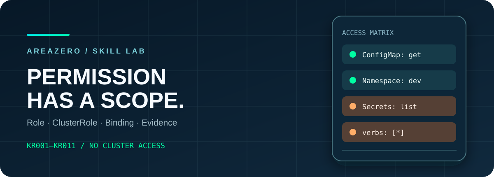
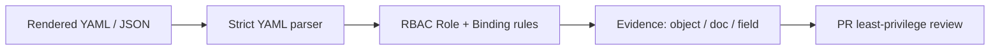

<p align="center"></p>
<p align="center"></p>

# Kubernetes RBAC Rights Audit

**Spot unintended authority before a manifest reaches the cluster.** A read-only, offline Agent Skill for Kubernetes/GitOps reviewers: scan Role, ClusterRole, RoleBinding and ClusterRoleBinding objects for wildcards, Secret reads, escalation verbs, pod exec, `cluster-admin` grants, sensitive groups and powerful default-service-account bindings.

[](https://github.com/Kanompung1988/k8s-rbac-rights-audit/actions/workflows/ci.yml) · [Agent Skills specification](https://agentskills.io/specification) · [Rules](references/RULES.md) · [Sources](references/SOURCES.md) · [MIT code license](LICENSE)

## The problem, with an important distinction

Kubernetes RBAC grants permissions based on verbs, resources, API groups and subjects; small policy changes may expand authority. For example, Kubernetes officially documents that listing Secrets can disclose data just as `get` can, and `bind`/`escalate`/`impersonate` are security-sensitive verbs. The distinction between a namespace-scoped **RoleBinding** referring to a ClusterRole and a **ClusterRoleBinding** granting cluster-wide rights is easy to miss in reviews. This tool highlights such *manifest evidence* — it **cannot** resolve permissions against a real cluster or prove exploitability.



## First run

```bash
git clone https://github.com/Kanompung1988/k8s-rbac-rights-audit.git
cd k8s-rbac-rights-audit
python -m pip install -r requirements.txt  # PyYAML 6.0.2
python scripts/audit.py examples/safe.yaml --format json --fail-on high
python scripts/audit.py examples/unsafe.yaml --format markdown --fail-on none
# Your own rendered manifests, not live cluster credentials:
python scripts/audit.py ./manifests --format json --fail-on high
```

**Exit codes:** `0` no findings at/above threshold, `2` review findings, `1` input/parse error. With `--fail-on none`, the tool reports without blocking. JSON reports source file, YAML document index, role kind/name/namespace, field path, severity, rule and remediation. It does **not** output Secret values.

### Synthetic example findings

The deliberately unsafe RBAC fixture produces review items such as:

```text
HIGH     KR001 ClusterRole intentionally-broad-demo rules[0].verbs (wildcard)
HIGH     KR003 ClusterRole intentionally-broad-demo rules[0] (secret list/read)
CRITICAL KR004 ClusterRole intentionally-broad-demo rules[1].verbs (bind/escalate)
CRITICAL KR007 ClusterRoleBinding intentionally-risky-demo roleRef (cluster-admin)
HIGH     KR009 ClusterRoleBinding intentionally-risky-demo subjects[0] (default SA)
```

No real cluster or credentials were used. The safe fixture defines a namespaced configmap reader and binding, and generates zero warnings under these limited rules.

## Install in Claude Code or Codex

```bash
# Claude Code project skill
mkdir -p .claude/skills
git clone --depth 1 https://github.com/Kanompung1988/k8s-rbac-rights-audit.git .claude/skills/k8s-rbac-rights-audit
# Codex project skill
mkdir -p .agents/skills
git clone --depth 1 https://github.com/Kanompung1988/k8s-rbac-rights-audit.git .agents/skills/k8s-rbac-rights-audit
```

**Agent prompt:** *"Review the rendered Kubernetes RBAC manifests in ./manifests offline. Explain findings by role, scope and specific field, compare proposed access to least privilege, and do not use kubectl, the network or cluster tokens."*

## Rule scope and testability

Eleven rule identifiers `KR001–KR011` (with `KR010`, `KR011`) are defined in [the rules reference](references/RULES.md) with technical guidance. The implementation scans only four RBAC `kind`s and safely skips other YAML objects, including Secret objects. It rejects duplicate YAML mapping keys, malformed structures, excessive input sizes, document counts and symlinked inputs; `yaml.SafeLoader` prevents arbitrary Python object construction.

- `scripts/audit.py`: deterministic Python 3.10+ CLI, pinned PyYAML 6.0.2.
- `tests/test_audit.py`: 33 synthetic tests covering wildcards, Secret read, group/scope nuances, protected YAML handling and CLI status.
- `examples/{safe,unsafe}.yaml`: inspectable fixtures, never apply unsafe fixture to a cluster.
- `.github/workflows/ci.yml`: independent CI matrix for Python 3.10 and 3.12, including fixtures.
- `SKILL.md` and `references/`: agent runbook and upstream Kubernetes security semantics.

Run `python -m unittest discover -s tests -v`. No cluster connectivity, no `kubectl`, no privileged environment is required. We intentionally don't auto-apply remediation. A RoleBinding to `cluster-admin` may still be scoped to one namespace; the tool rates it High rather than Critical to preserve nuance.

## Limitations and security

This is **not** a Kubernetes effective-rights evaluator: it does not follow roleRef to other manifests, resolve aggregation, evaluate admission/OPA, service account impersonation semantics, role renames, API discovery, admission mutations or cluster configuration. YAML parsing processes local file content in memory but reports only RBAC metadata; treat untrusted arbitrary YAML as potentially resource-intensive and review it in an isolated CI runner. Permission findings can be intentional and should be human-reviewed. See [official Kubernetes RBAC good practices](https://kubernetes.io/docs/concepts/security/rbac-good-practices/).

## Contributing and licensing

Bug reports with safe synthetic reproduction welcome via Issues. See [CONTRIBUTING.md](CONTRIBUTING.md), [SECURITY.md](SECURITY.md), and [primary sources](references/SOURCES.md). Original code/docs © 2026 AREAZERO Skill Lab are MIT; owner-supplied official Area Zero identity is **excluded from MIT**, linked here unmodified. Please replace brand marks in forks.
